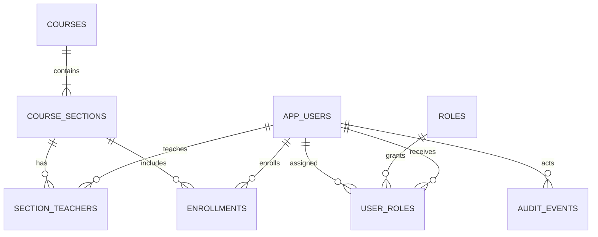
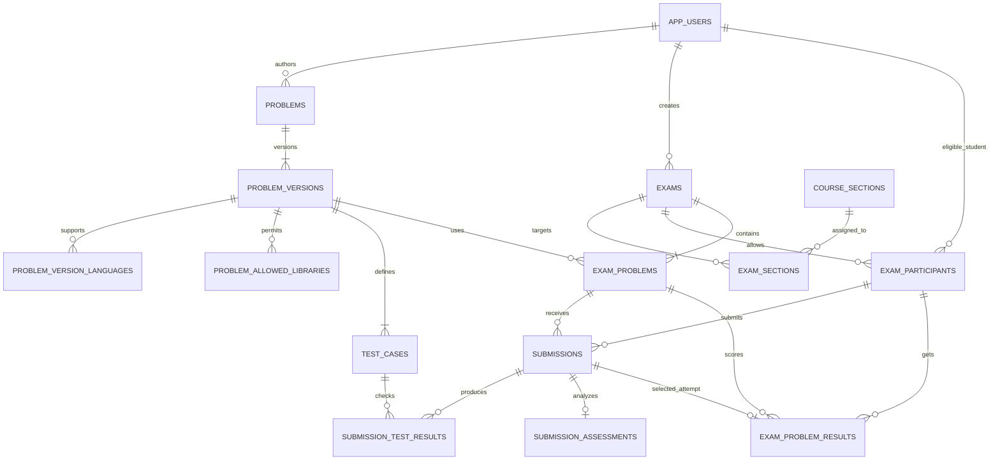

# IPASS database ER diagram

This diagram is a logical overview of the PostgreSQL draft in `schema.sql`.

## Users and classroom-style groups

## Problems, exams, and grading

## Notes

- `exam_participants` is the final eligibility roster for a particular exam. It can be populated from one or more course sections and adjusted by the teacher.
- `exam_problems.problem_version_id` pins the exact problem version and its test cases used by that exam.
- Hidden test inputs and expected outputs are stored in `test_cases`; student-facing APIs must return only public test cases and must never expose hidden expected outputs.
- `submission_assessments` stores LLM evidence and rubric output. The backend remains responsible for validating that output and calculating final scores.
- The schema does not decide submission attempt limits, which attempt counts, or the final grade release policy. Those need product decisions before production migrations.
